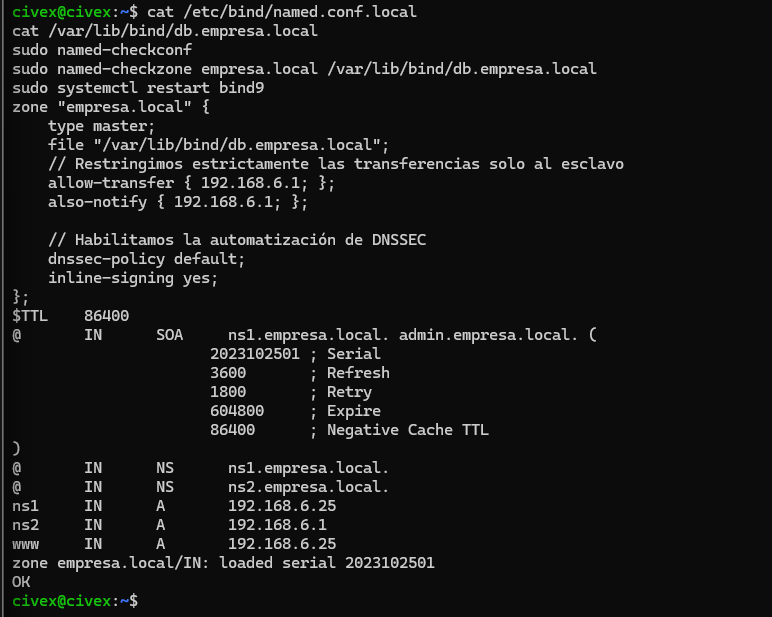
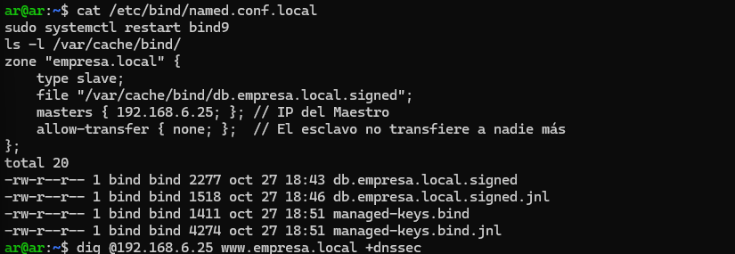
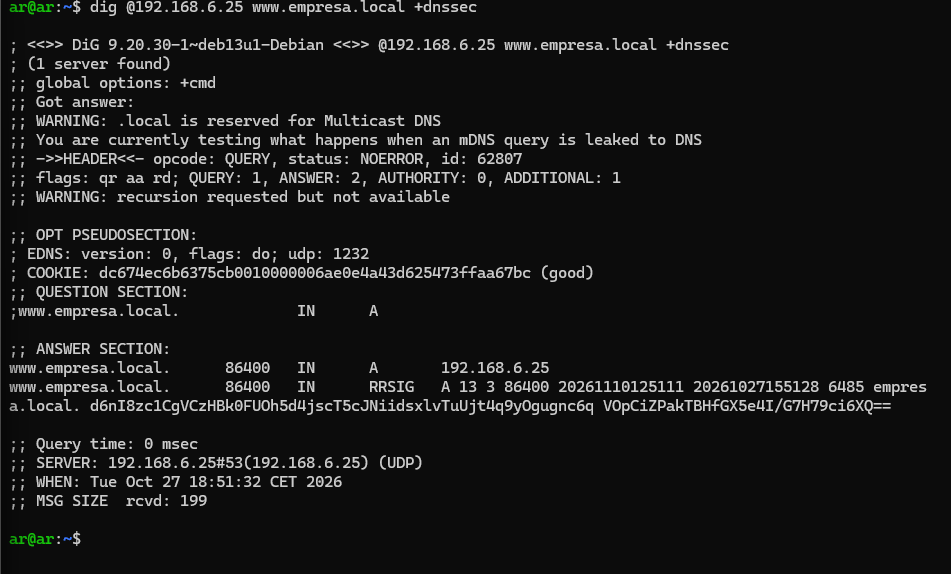
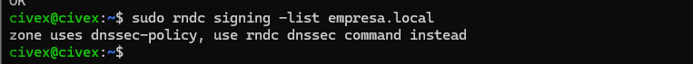

# Securización de Servidores DNS con DNSSEC

## 1. El problema del DNS original
El protocolo DNS se diseñó asumiendo que la red era de confianza. Al viajar sobre UDP en el puerto 53 y en texto claro es vulnerable. Carece de mecanismos para verificar si la respuesta viene del servidor legítimo y no permite comprobar si un intermediario ha alterado los datos (Man-in-the-Middle). 

Además al no tener un handshake a nivel de transporte es fácil falsificar la IP de origen (IP Spoofing) y usarlo para ataques DDoS por amplificación. Las consultas viajan en texto claro lo que permite la inspección pasiva (eavesdropping) y el secuestro de consultas (DNS hijacking).

## 2. Cómo securizamos el servicio DNS
Para desplegar un servicio seguro he aplicado las siguientes medidas:
* **Aislamiento de roles:** Desactivé la recursión con `recursion no` en ambos servidores. Un servidor autoritativo nunca debe hacer resolución recursiva para evitar ataques DDoS por amplificación.
* **Restricción de transferencias:** Usé `allow-transfer` para que solo la IP del esclavo pueda descargar la zona del maestro. Esto mitiga el reconocimiento no autorizado (AXFR/IXFR).
* **Firmas digitales:** Activé DNSSEC para garantizar que los registros no han sido alterados en tránsito y verificar la autenticidad de las respuestas.

## 3. A considerar
* **Consumo de recursos:** El uso de DNSSEC aumenta el consumo de CPU y RAM en los servidores pero es un coste necesario para la integridad.
* **Riesgo de expiración:** Para evitar caídas del servicio auto-provocadas por una mala rotación de claves o expiración de firmas (RRSIG) usé la directiva `dnssec-policy default`. Esto hace que BIND gestione y rote las claves (ZSK y KSK) de forma automática.
* **Aislamiento:** Cumpliendo la norma nunca permití que un mismo servidor actuara como autoritativo y recursivo a la vez.

## 4. Configuración y Pruebas

**Topología de red:**
* Servidor Maestro: Ubuntu en `192.168.6.25`
* Servidor Esclavo: Debian 13 en `192.168.6.1`
* Dominio de pruebas: `empresa.local`

### A. Configuración del Maestro (Ubuntu)
Configuro la zona autoritativa y aplico la política DNSSEC automática.

```bash
cat /etc/bind/named.conf.local
cat /var/lib/bind/db.empresa.local
sudo named-checkconf
sudo named-checkzone empresa.local /var/lib/bind/db.empresa.local
sudo systemctl restart bind9
````



Explicación: En esta captura se observa la directiva dnssec-policy default y el allow-transfer restringido. Los comandos de chequeo no devuelven error lo que confirma que la sintaxis es correcta.

B. Configuración del Esclavo (Debian)
Le indico la IP del maestro para que descargue la zona firmada.

```bash
cat /etc/bind/named.conf.local
sudo systemctl restart bind9
ls -l /var/cache/bind/

```

Explicación: Se puede ver cómo el esclavo ha descargado el archivo .signed lo que demuestra que la transferencia AXFR se ha completado correctamente.

C. Pruebas desde el Cliente (Debian)
Uso la máquina Debian como cliente para consultar al maestro pidiendo el flag de seguridad.

```bash

dig @192.168.6.25 www.empresa.local +dnssec
 
```

Explicación: En la sección ANSWER se aprecia el registro RRSIG. Esta es la firma digital que garantiza que la respuesta proviene del servidor legítimo y no ha sido manipulada.

D. Verificación final en el Maestro
Compruebo que el proceso de firma ha terminado correctamente.

```bash
sudo rndc signing -list empresa.local

```

Explicación: El mensaje Done signing confirma que BIND ha generado las claves ZSK y KSK y ha firmado la zona sin errores.
